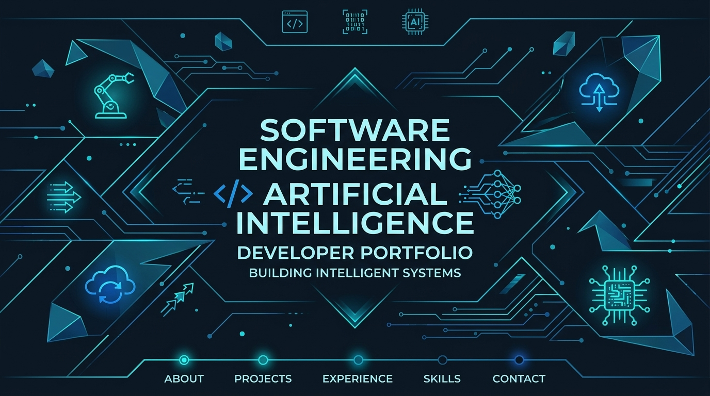

  <!-- Banner principal do repositório -->
  
  
    

  <h1>🚀 Rafael Tozato | Portfólio Profissional</h1>
  
<b>Engenheiro de Software & Especialista em Engenharia 4.0, Automação, BI e IA</b>

  
Hub central e ecossistema de aplicações focados em transformar código e inteligência em soluções de alto impacto.

 

---

## 📄 Retrospectiva Profissional & Trajetória

  <h3>"Da Bancada à Engenharia 4.0"</h3>
  
Confira o material em PDF com a trajetória completa, marcos de carreira, governança e ecossistema técnico.

  

---

## 🛠️ Stack Tecnológica & Ecossistema

  
  
  
  
  
  
    
  
  
  

---

## 📌 Sobre o Projeto
Este repositório (`rafael-tozato-portfolio-dev`) contém a aplicação principal do meu portfólio web, projetada com design dark/cyan, navegação fluida, métricas, projetos em destaque, certificações e curadoria de conteúdos técnicos.

---

## 💻 PROJETOS E PORTFÓLIOS
- **App Ecosystem:** [tozato-ai-core.vercel.app](https://tozato-ai-core.vercel.app)

## 🐙 CÓDIGO E REPOSITÓRIOS
- **GitHub:** [github.com/Rafael-TOZATO](https://github.com/Rafael-TOZATO)

## ✍️ ARTIGOS E PUBLICAÇÕES
- **Medium:** [medium.com/@ornelas.tozato](https://medium.com/@ornelas.tozato)

## 📬 CONTATOS
- **LinkedIn:** [rafaeltozato81](https://www.linkedin.com/in/rafaeltozato81)
- **GitHub:** [Rafael-TOZATO](https://github.com/Rafael-TOZATO)
- **Medium:** [@ornelas.tozato](https://medium.com/@ornelas.tozato)
- **Dev Hub:** [tozato-ai-core.vercel.app](https://tozato-ai-core.vercel.app)
- **Microsoft Learn:** [rafaelornelastozato-2209](https://learn.microsoft.com/pt-br/users/rafaelornelastozato-2209)

## Governança e segurança

- **Quality Gate:** instalação reproduzível com lockfile congelado, auditoria de dependências, verificação TypeScript e build em pushes e pull requests para `main`.
- **SAST:** GitHub CodeQL analisa JavaScript e TypeScript em pushes, pull requests e execução agendada.
- **Dependências:** Dependabot monitora pacotes npm e GitHub Actions; o Dependency Review falha o check em pull requests com vulnerabilidades de alta severidade.
- **Princípio de menor privilégio:** workflows usam permissões mínimas de leitura, exceto as permissões estritamente necessárias para publicar resultados do CodeQL.
- **Proteção de `main`:** os checks são executados em pushes e pull requests; para bloquear merges sem aprovação dos checks, a proteção da branch deve ser habilitada nas configurações do GitHub.
- **Dados pessoais:** documentos acadêmicos e registros financeiros identificáveis não são destacados no portfólio sem sanitização e revisão de privacidade.
- **APIs:** este repositório do portfólio não expõe rotas de API; chaves de integração não devem ser incluídas no código ou nos workflows.

---

## Governança 4.0 — Segurança e Qualidade

Este repositório adota controles automatizados de Governança 4.0 para fortalecer a integridade da cadeia de suprimentos de software, a rastreabilidade das alterações e a prevenção de exposição de credenciais.

- **Quality Gate:** validação automatizada compatível com a natureza técnica do repositório, executada em pushes e pull requests direcionados à branch principal.
- **Segurança de segredos:** análise contínua do histórico Git com Gitleaks Action v3.0.0, incluindo varredura integral do histórico.
- **SAST:** análise estática com GitHub CodeQL quando aplicável ao código-fonte JavaScript e TypeScript.
- **Dependências:** instalação reproduzível por lockfile e auditoria de vulnerabilidades nos projetos que mantêm dependências de aplicação.
- **Menor privilégio:** permissões mínimas declaradas nos workflows e credenciais de checkout não persistidas no ambiente de execução.
- **Rastreabilidade:** execuções e resultados permanecem disponíveis no GitHub Actions; os badges refletem o estado real dos workflows.

