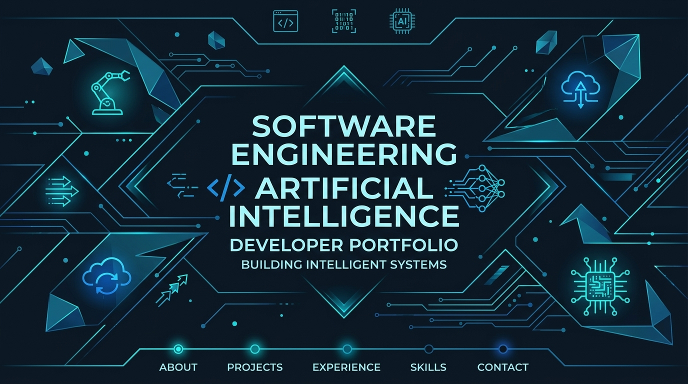

  <!-- Banner principal do repositório -->
  
  
    

  <h1>🚀 Rafael Tozato | Portfólio Profissional</h1>
  
<b>Engenheiro de Software & Especialista em Engenharia 4.0, Automação, BI e IA</b>

  
Hub central e ecossistema de aplicações focados em transformar código e inteligência em soluções de alto impacto.

 

---

## 📄 Retrospectiva Profissional & Trajetória

  <h3>"Da Bancada à Engenharia 4.0"</h3>
  
Confira o material em PDF com a trajetória completa, marcos de carreira, governança e ecossistema técnico.

  

---

## 🛠️ Stack Tecnológica & Ecossistema

  
  
  
  
  
  

---

## 📌 Sobre o Projeto
Este repositório (`rafael-tozato-portfolio-dev`) contém a aplicação principal do meu portfólio web, projetada com design dark/cyan, navegação fluida, métricas, projetos em destaque, certificações e curadoria de conteúdos técnicos.

---

## 🌐 Links & Contatos
* 🔗 **Portfólio em Produção:** [Acessar Aplicação](https://h-folio-l0.vercel.app)
* 💼 **LinkedIn:** [Rafael Tozato](https://www.linkedin.com/in/rafael-tozato)
* 🐙 **GitHub Profile:** [@Rafael-TOZATO](https://github.com/Rafael-TOZATO)
