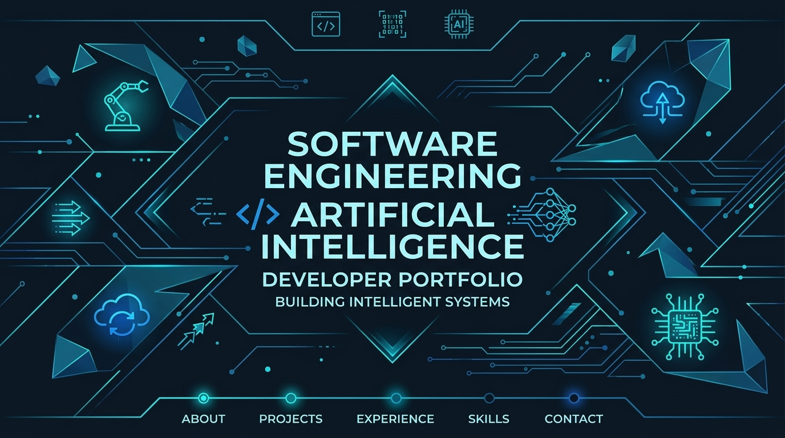

  <!-- Banner principal do repositório -->
  
  
    

  <h1>🚀 Rafael Tozato | Portfólio Profissional</h1>
  
<b>Engenheiro de Software & Especialista em Engenharia 4.0, Automação, BI e IA</b>

  
Hub central e ecossistema de aplicações focados em transformar código e inteligência em soluções de alto impacto.

 

---

## 📄 Retrospectiva Profissional & Trajetória

  <h3>"Da Bancada à Engenharia 4.0"</h3>
  
Confira o material em PDF com a trajetória completa, marcos de carreira, governança e ecossistema técnico.

  

---

## 🛠️ Stack Tecnológica & Ecossistema

  
  
  
  
  
  
    
  
  
  

---

## 📌 Sobre o Projeto
Este repositório (`rafael-tozato-portfolio-dev`) contém a aplicação principal do meu portfólio web, projetada com design dark/cyan, navegação fluida, métricas, projetos em destaque, certificações e curadoria de conteúdos técnicos.

---

## 🛡️ Governança 4.0 — Segurança e Qualidade

Este repositório adota controles automatizados de Governança 4.0 para assegurar integridade dos artefatos e do código, rastreabilidade das alterações, gestão de dependências e prevenção de exposição de credenciais. Os controles são aplicados conforme a natureza técnica e os componentes efetivamente mantidos no projeto.

- **Quality Gate:** validação automatizada do escopo do repositório, incluindo verificações de integridade, testes, análise estática, tipagem ou build quando aplicáveis.
- **Segurança de segredos:** varredura do histórico Git com Gitleaks Action v3.0.0.
- **SAST:** análise com GitHub CodeQL para linguagens suportadas e presentes no código-fonte.
- **Dependências:** monitoramento automatizado e revisão de vulnerabilidades conforme os manifests e lockfiles existentes.
- **Menor privilégio:** permissões mínimas nos workflows e checkout sem persistência desnecessária de credenciais.
- **Rastreabilidade:** commits, execuções e resultados dos controles permanecem registrados no GitHub Actions.

---

---

## 📬 CONTATOS E PERFIS

💻 **PROJETOS E PORTFÓLIOS**
* Ecossistema de Aplicativos: [tozato-ai-core.vercel.app](https://tozato-ai-core.vercel.app)
* H-Folio Professional: [h-folio-I0.vercel.app](https://h-folio-I0.vercel.app)

🐙 **CÓDIGOS E REPOSITÓRIOS**
* GitHub: [github.com/Rafael-TOZATO](https://github.com/Rafael-TOZATO)

✍️ **ARTIGOS E PUBLICAÇÕES**
* Medium: [medium.com/@ornelas.tozato](https://medium.com/@ornelas.tozato)
* Comunidade DEV: [dev.to/rafaeltozato](https://dev.to/rafaeltozato)

💼 **CONTATO**
* LinkedIn: [linkedin.com/in/rafaeltozato81](https://www.linkedin.com/in/rafaeltozato81)
* E-mail: [ornelas.tozato@gmail.com](mailto:ornelas.tozato@gmail.com)
  
